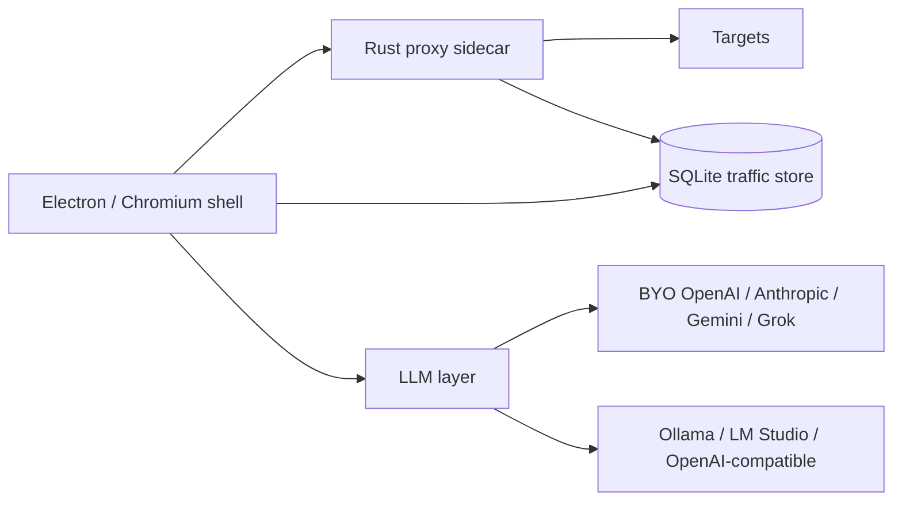

# Lurkwire

Burp Suite + an LLM, built into a browser you live in.

## Status

Pre-alpha, under active development. Ubuntu/Linux first, then macOS and Windows.

## What it is

Lurkwire is an AI-native security browser for developers, pentesters, and bug bounty hunters. It is a daily-driver Chromium browser with a built-in intercepting proxy, Repeater, fuzzer, and scanner, plus your own or local LLMs. Capture works with zero setup because the proxy is built into the browser — and the AI drafts while a human always sends.

## Features (v0.1)

- Electron/Chromium daily-driver browser with Proton-style chrome, multi-window, private windows, and lurkwire:// settings tabs
- Rust intercepting TLS MITM proxy with a per-install CA trusted only inside the app (never system-wide)
- HTTP/2 to the upstream when the target supports it; the browser-facing MITM stays HTTP/1.1
- Per-project traffic store and Burp-parity workbench: sortable HTTP history, Monaco Raw/Pretty/Hex/Headers/Render, site map, Comparer, Sequencer-lite, Logger, highlights, comments, and Send to Repeater/Intruder/Comparer
- Intercept (pause, edit, forward, or drop)
- Repeater and Intruder-lite
- JWT/session tooling and encode/decode
- Interactsh OOB collaborator
- Passive scanner and anomaly detection
- Recon / site-intel panel (crt.sh, DNS, RDAP/WHOIS, Wayback, optional Shodan) plus a lock-icon site info panel
- Native per-tab Chrome DevTools
- Unpacked Chrome extension loading (no Web Store; Electron `chrome.*` subset)
- Settings > AI connectors: OpenAI, Anthropic, Gemini, xAI Grok, OpenRouter, Ollama, LM Studio, or a custom OpenAI-compatible endpoint, with list-models, connection tests, per-task routing, and local per-task memory — AI drafts, a human always sends

## Guardrails by design

- Scope allowlist enforced in the proxy
- Rate limiting
- Global kill switch
- Append-only, hash-chained audit log
- Authorization attestation per project
- Secret redaction before anything goes to a cloud model
- Local-only mode

## Architecture at a glance



## Repository layout

- `apps/desktop` — Electron shell (React + Vite)
- `crates/lurkwire-proxy` — Rust intercepting proxy sidecar
- `docs/PROGRESS.md` — module checklist

## Development

Prerequisites: Node 20+, Rust (cargo/rustc), curl (for proxy MITM tests), and the usual Linux desktop libraries Electron needs (GTK, NSS).

```bash
# from the repo root
npm install
npm test              # proxy tests + desktop unit tests
npm run build:proxy:debug
npm run dev           # build the sidecar, then start the desktop app
```

Useful splits:

```bash
npm run dev:proxy     # cargo run -p lurkwire-proxy
npm run dev:ui        # Electron UI only
npm run build         # release sidecar + packaged renderer/main
npm run smoke         # load https://example.com through the proxy, check History, write docs/screenshots/
```

### Run the proxy on its own

The sidecar prints one JSON line to stdout when it is ready (listen addresses, CA path, auth token). Tracing goes to stderr.

```bash
cargo run -p lurkwire-proxy -- --data-dir ./.data --listen 127.0.0.1:8080 --control 127.0.0.1:8787
# in another terminal:
curl -x http://127.0.0.1:8080 --cacert ./.data/ca.pem https://example.com/
curl -sS -H "Authorization: Bearer <token from the ready line>" http://127.0.0.1:8787/flows
```

The per-install CA is written to `<data-dir>/ca.pem` and is intended to be trusted only inside Lurkwire, not installed system-wide. The control API requires the bearer token on every route, including `/health`.


## Install on Linux

Build the desktop packages (release sidecar, Electron app, AppImage, and deb):

```bash
npm run dist:linux
```

Artifacts are written to `dist/` at the repo root, including a `.deb` and an `.AppImage`. Install the deb (this also adds Lurkwire to the Ubuntu app menu):

```bash
sudo apt install ./dist/lurkwire_*.deb
```

Or run the AppImage in place after making it executable (`chmod +x dist/Lurkwire-*.AppImage`).

## Roadmap

Linux first, then macOS and Windows. See [docs/PROGRESS.md](docs/PROGRESS.md) for the module-by-module checklist.

## Disclaimer

Lurkwire is provided "as is", without warranty of any kind. You are solely responsible for how you use it and for complying with all applicable laws and the terms of any service or program you interact with. The authors and contributors accept no liability for any misuse, damage, data loss or legal consequences arising from the use of this software.

Chrome icons are from [Lucide](https://lucide.dev) (ISC). See [THIRD_PARTY_NOTICES](THIRD_PARTY_NOTICES).

## License

TBD
