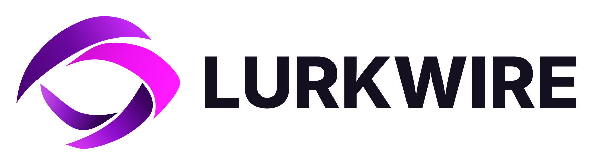
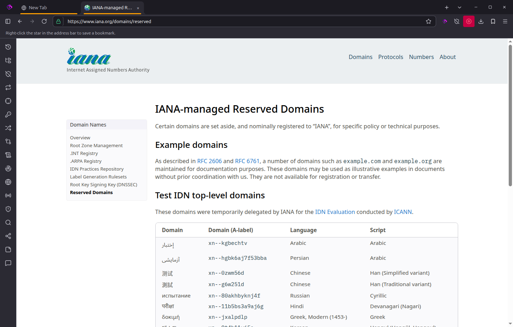
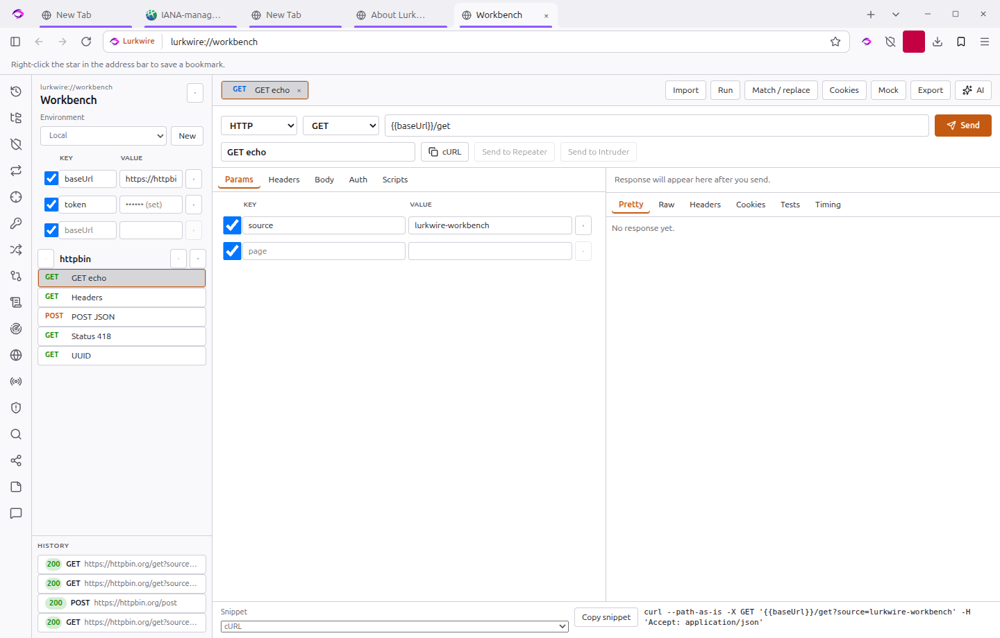
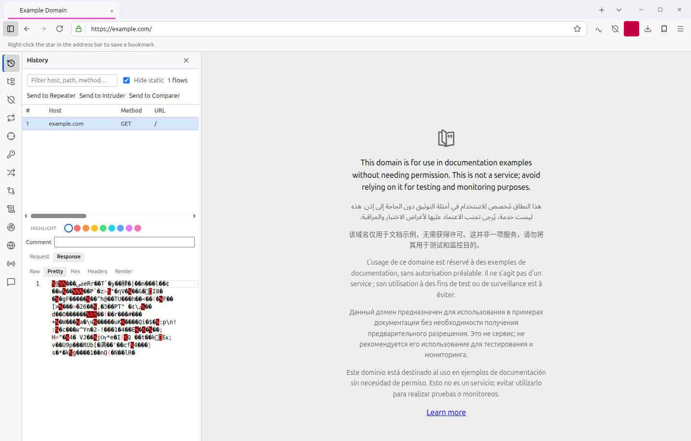
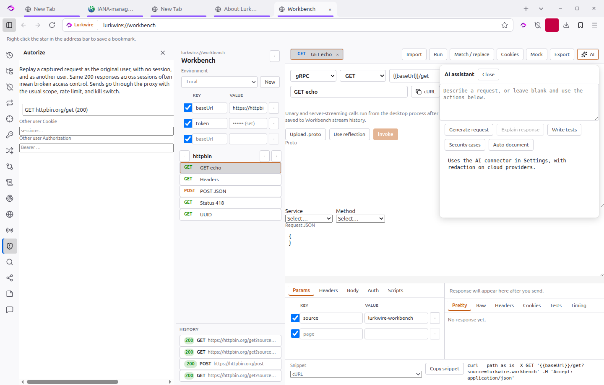
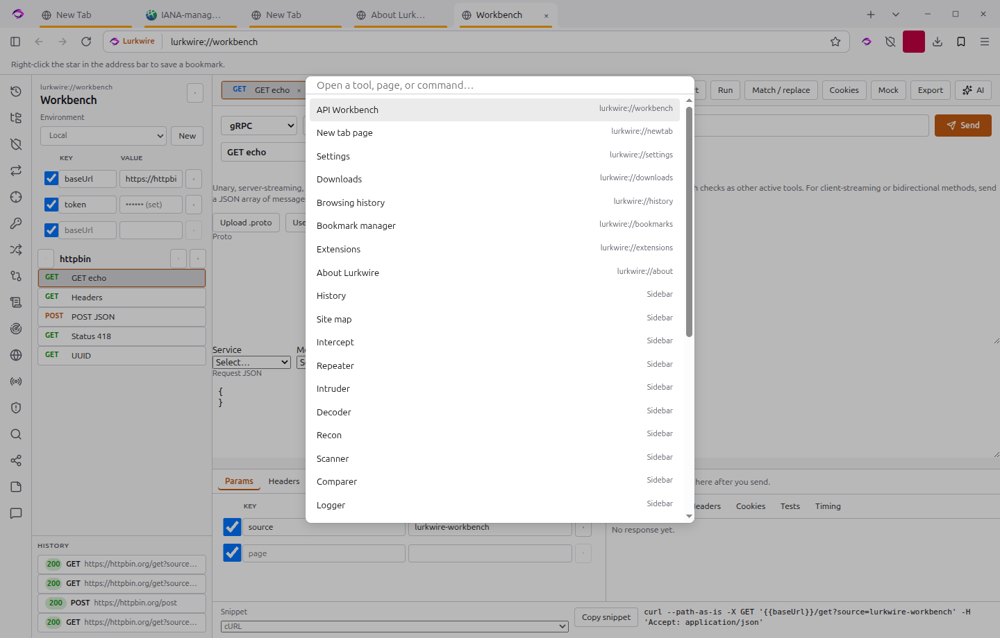
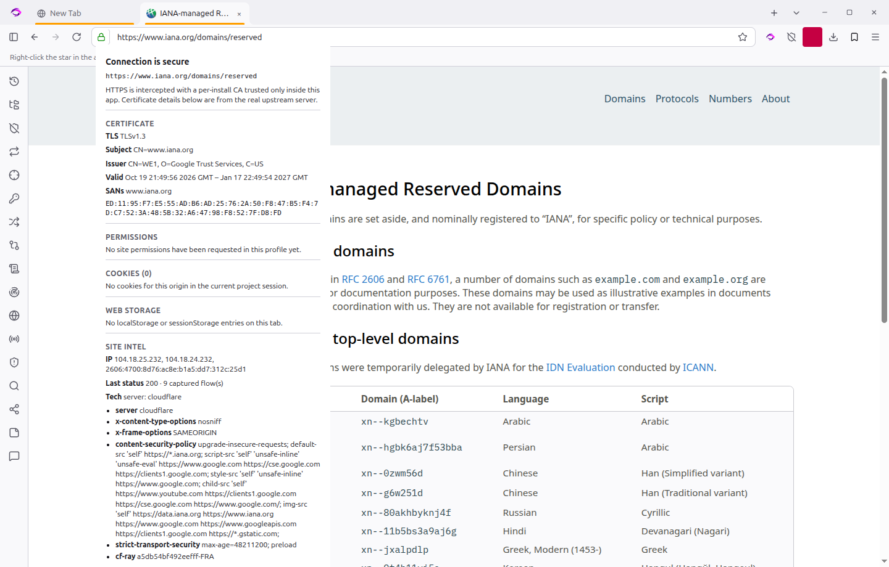
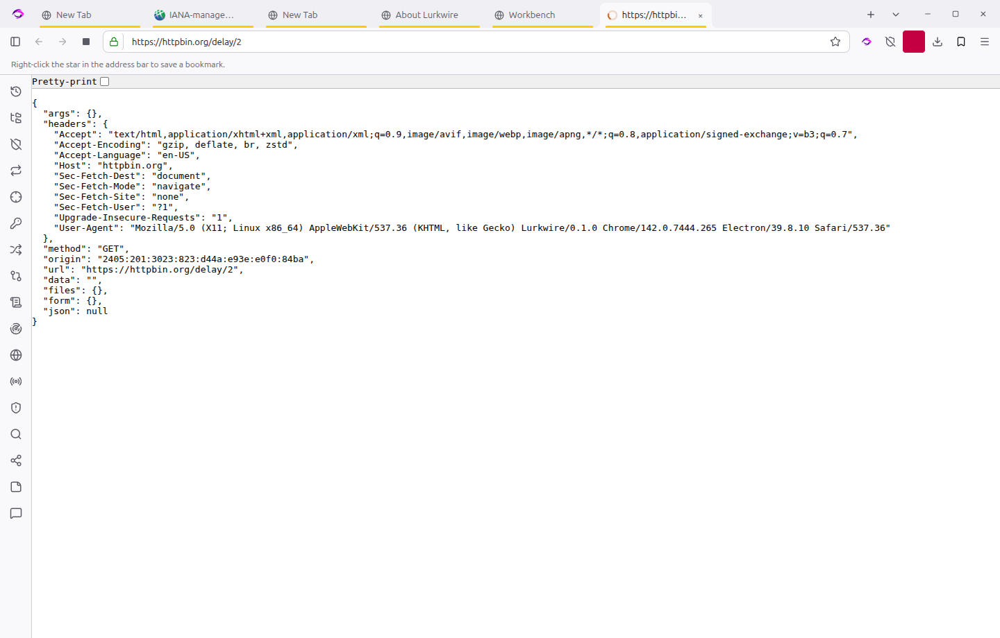
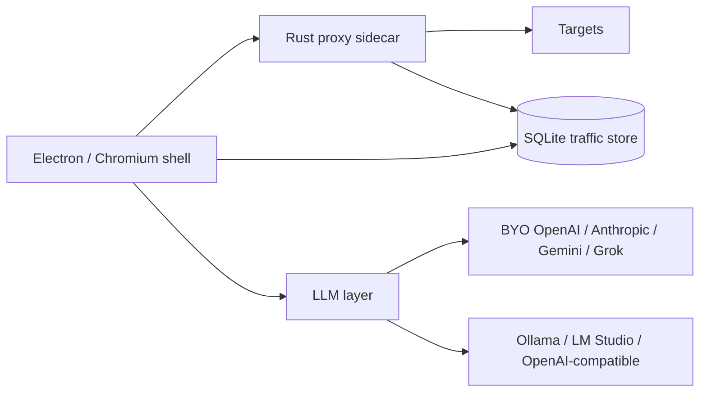

# Lurkwire

<p align="center">
  <picture>
    <source media="(prefers-color-scheme: dark)" srcset="resources/brand/lurkwire-wordmark-light.svg">
    <source media="(prefers-color-scheme: light)" srcset="resources/brand/lurkwire-wordmark-dark.svg">
    
  </picture>
  <br>
  <strong>Burp Suite + an LLM, built into a browser you live in.</strong>
</p>

<p align="center">
  
  
  
  
  
  
  
  
  
  
  
  
</p>

## Table of contents

- [Status](#status)
- [What it is](#what-it-is)
- [Why Lurkwire](#why-lurkwire)
- [Screenshots](#screenshots)
- [Features](#features)
- [For collaborators and testers](#for-collaborators-and-testers)
- [Guardrails by design](#guardrails-by-design)
- [Architecture at a glance](#architecture-at-a-glance)
- [Repository layout](#repository-layout)
- [Development](#development)
- [Install on Linux](#install-on-linux)
- [Roadmap](#roadmap)
- [Disclaimer](#disclaimer)
- [License](#license)

## Status

Pre-alpha, under active development. Ubuntu/Linux first, then macOS and Windows.

## What it is

Lurkwire is an AI-native security browser for developers, pentesters, and bug bounty hunters. It is meant to be the browser you already work in, not another tool you context-switch to: Chromium with Proton-style chrome, plus an intercepting TLS proxy, a Burp-parity side bench, and a Postman-class API client, all in the same window.

The usual workflow splits attention across a daily browser, Burp or Caido for intercept and replay, Postman or Insomnia for API work, and ChatGPT or a local model for drafts. Requests get copied, cookies drift, and the model never sees the traffic you actually captured.

Lurkwire collapses that into one app. A Rust sidecar MITM is built into the browser, so capture needs no system proxy or system-wide CA — the per-install certificate is trusted only inside the app. History, Repeater, Intruder, Intercept, and the rest of the workbench sit beside the page you are looking at. `lurkwire://workbench` is a full API client with collections, environments, scripts, and gRPC, WebSocket, and SSE clients. Settings can point at OpenAI, Anthropic, Gemini, xAI Grok, OpenRouter, Ollama, LM Studio, or any OpenAI-compatible endpoint. The model can draft; a human always sends.

It is local-first. Scope, rate limits, a global kill switch, and a hash-chained audit log are enforced in the proxy. Secrets are redacted before anything goes to a cloud model, and you can stay on a local-only provider.

## Why Lurkwire

- Capture with no extra proxy setup — the MITM rides inside the browser
- Per-install CA trusted only in-app, never system-wide, and fail-closed if the sidecar is down
- Burp-parity tools and a Postman-class Workbench in the same window as the page
- Bring your own cloud LLM or a local one (Ollama, LM Studio, or a custom endpoint)
- The model drafts; a human always sends
- Scope allowlist, rate limits, a global kill switch, and a hash-chained audit log
- Secret redaction before cloud providers, plus a local-only mode

## Screenshots

<p align="center">
  
</p>

| Workbench | History | Autorize |
| :---: | :---: | :---: |
|  |  |  |
| **Command palette** | **Site info** | **Tab throbber** |
|  |  |  |

## Features

### Browser

- Electron/Chromium daily-driver with Proton-style chrome, multi-window, private windows, and `lurkwire://` pages (settings, new tab, Workbench, and more)
- Firefox-style tab throbber, tab groups, bookmarks with optional Chrome/Firefox import, and optional session restore
- Command palette (Ctrl+K) and API Workbench (Ctrl+Shift+M or `lurkwire://workbench`)
- Native per-tab Chrome DevTools
- Unpacked Chrome extension loading (no Web Store; Electron `chrome.*` subset)
- Lock-icon site info: upstream certificate, permissions, cookie manager (copy, delete, Netscape export), and the tab's localStorage / sessionStorage

### Proxy and capture

- Rust intercepting TLS MITM sidecar with a per-install CA trusted only inside the app (never system-wide)
- HTTP/2 to the upstream when the target supports it; the browser-facing MITM stays HTTP/1.1
- Per-project traffic store
- Intercept: pause, edit, forward, or drop

### History and Burp-parity tools

- Sortable HTTP History with Monaco Raw / Pretty / Hex / Headers / Render viewers, highlights, and comments
- Send to Repeater, Intruder, Comparer, or Workbench; copy as cURL; add the host to scope
- HAR export of visible history, site map from History (Markdown export)
- CSRF and clickjacking PoC generators, in-scope CORS preflight retest, and "send JWT to Decoder"
- Repeater and Intruder-lite (sniper / pitchfork / battering ram, payload presets, load-from-file wordlists)
- Autorize-style session replay and response diff
- Comparer, Sequencer-lite, and Logger++ filters and highlight rules
- Decoder with JWT (including HS* re-sign and alg none) and recipe chains
- Passive scanner and anomaly flags, including CL.TE and unkeyed-header cache-poisoning hints, plus a localhost-only CL.TE smuggling lab
- Recon / site-intel (crt.sh, DNS, RDAP/WHOIS, Wayback, optional Shodan BYO key)
- Interactsh OOB collaborator
- Notes / findings tracker with a CVSS 3.1 calculator and Markdown export (evidence links back to History)
- In-scope directory/content discovery and JavaScript endpoint / secret extraction, with one-click accept of high-confidence secrets into Notes
- GraphQL introspection explorer with a type-relationship graph

### API Workbench

- Collections, environments and secrets (via `safeStorage`), auth helpers, pre-request and test scripts
- Collection runner with CSV/JSON data files, code snippets, and import/export (Postman, Insomnia, OpenAPI JSON or YAML, HAR, cURL)
- Editable cookie jar: Netscape import/export, Cookie header copy, and import from the project browser session
- Match-and-replace rules with starter template packs
- Collection mock server, binary body picker, and OAuth 2.0 authorization-code + PKCE
- WebSocket, SSE, and gRPC clients (unary, server-streaming, client-streaming, and bidirectional, with proto upload or server reflection); frames persist in Workbench stream history
- Send to Repeater or Intruder; AI helpers for generate / explain / tests, with redaction on cloud providers

### AI

- Settings > AI connectors: OpenAI, Anthropic, Gemini, xAI Grok, OpenRouter, Ollama, LM Studio, or a custom OpenAI-compatible endpoint
- List-models, connection tests, per-task routing, and local per-task memory
- AI drafts; a human always sends

## For collaborators and testers

This repository is private. You cannot clone it until the owner invites you and you accept the invite.

### Get invited

The owner invites you from the GitHub repo: **Settings → Collaborators and teams → Add people**, then enters your GitHub username or email. GitHub sends an email and an in-app notification. Open the invite and accept it. Until you do, clone and `git fetch` will fail.

### Clone the repo

SSH (preferred if you have a GitHub SSH key):

```bash
git clone git@github.com:kritarth1107/lurkwire.git
cd lurkwire
```

HTTPS:

```bash
git clone https://github.com/kritarth1107/lurkwire.git
cd lurkwire
```

### Prerequisites

- Node.js 20 or newer
- Rust (`cargo` / `rustc`)
- curl (used by some proxy tests)
- The usual Linux desktop libraries Electron needs (GTK, NSS)

### First-time setup

From the repo root:

```bash
npm install
npm run build:proxy:debug
npm run dev
```

`npm run dev` builds the debug proxy sidecar and starts the desktop app.

### Tests

```bash
npm test
```

This runs the Rust proxy tests and the desktop unit tests.

### Packaged Linux build

```bash
npm run dist:linux
```

Artifacts land in `dist/` at the repo root. Install the deb (this also adds Lurkwire to the Ubuntu app menu):

```bash
sudo apt install ./dist/lurkwire_*.deb
```

Or run the AppImage in place after `chmod +x dist/Lurkwire-*.AppImage`. You do not need to install the deb if you only want to try the AppImage.

### Smoke tests

```bash
npm run smoke
```

After a packaged build, you can also smoke the AppImage (it writes screenshots to `docs/screenshots/`):

```bash
npm run smoke:appimage
```

### Open Workbench

In the running app, open `lurkwire://workbench` or press Ctrl+Shift+M (also under the app menu as API Workbench). Active tools honor the project's scope allowlist and the global kill switch — only test systems you are authorized to test.

### Pull requests

Branch off `main`, push your branch, and open a pull request. Do not push straight to `main` unless the owner asks you to.

### Where to look

- [docs/PROGRESS.md](docs/PROGRESS.md) — module checklist and what is already on `main`
- [docs/screenshots/](docs/screenshots/) — current UI screenshots from the packaged smoke
- The Development and Install on Linux sections below, if you need proxy-only or packaging detail

## Guardrails by design

- Scope allowlist enforced in the proxy
- Rate limiting
- Global kill switch
- Append-only, hash-chained audit log
- Authorization attestation per project
- Secret redaction before anything goes to a cloud model
- Local-only mode

## Architecture at a glance



## Repository layout

- `apps/desktop` — Electron shell (React + Vite)
- `crates/lurkwire-proxy` — Rust intercepting proxy sidecar
- `docs/PROGRESS.md` — module checklist

## Development

Prerequisites: Node 20+, Rust (cargo/rustc), curl (for proxy MITM tests), and the usual Linux desktop libraries Electron needs (GTK, NSS).

```bash
# from the repo root
npm install
npm test              # proxy tests + desktop unit tests
npm run build:proxy:debug
npm run dev           # build the sidecar, then start the desktop app
```

Useful splits:

```bash
npm run dev:proxy     # cargo run -p lurkwire-proxy
npm run dev:ui        # Electron UI only
npm run build         # release sidecar + packaged renderer/main
npm run smoke         # load https://example.com through the proxy, check History, write docs/screenshots/
```

### Run the proxy on its own

The sidecar prints one JSON line to stdout when it is ready (listen addresses, CA path, auth token). Tracing goes to stderr.

```bash
cargo run -p lurkwire-proxy -- --data-dir ./.data --listen 127.0.0.1:8080 --control 127.0.0.1:8787
# in another terminal:
curl -x http://127.0.0.1:8080 --cacert ./.data/ca.pem https://example.com/
curl -sS -H "Authorization: Bearer <token from the ready line>" http://127.0.0.1:8787/flows
```

The per-install CA is written to `<data-dir>/ca.pem` and is intended to be trusted only inside Lurkwire, not installed system-wide. The control API requires the bearer token on every route, including `/health`.


## Install on Linux

Build the desktop packages (release sidecar, Electron app, AppImage, and deb):

```bash
npm run dist:linux
```

Artifacts are written to `dist/` at the repo root, including a `.deb` and an `.AppImage`. Install the deb (this also adds Lurkwire to the Ubuntu app menu):

```bash
sudo apt install ./dist/lurkwire_*.deb
```

Or run the AppImage in place after making it executable (`chmod +x dist/Lurkwire-*.AppImage`).

## Roadmap

Linux first, then macOS and Windows. See [docs/PROGRESS.md](docs/PROGRESS.md) for the module-by-module checklist.

## Disclaimer

Lurkwire is provided "as is", without warranty of any kind. You are solely responsible for how you use it and for complying with all applicable laws and the terms of any service or program you interact with. The authors and contributors accept no liability for any misuse, damage, data loss or legal consequences arising from the use of this software.

Chrome icons are from [Lucide](https://lucide.dev) (ISC). See [THIRD_PARTY_NOTICES](THIRD_PARTY_NOTICES).

## License

Lurkwire is licensed under the Lurkwire Proprietary License. See [LICENSE](LICENSE).
