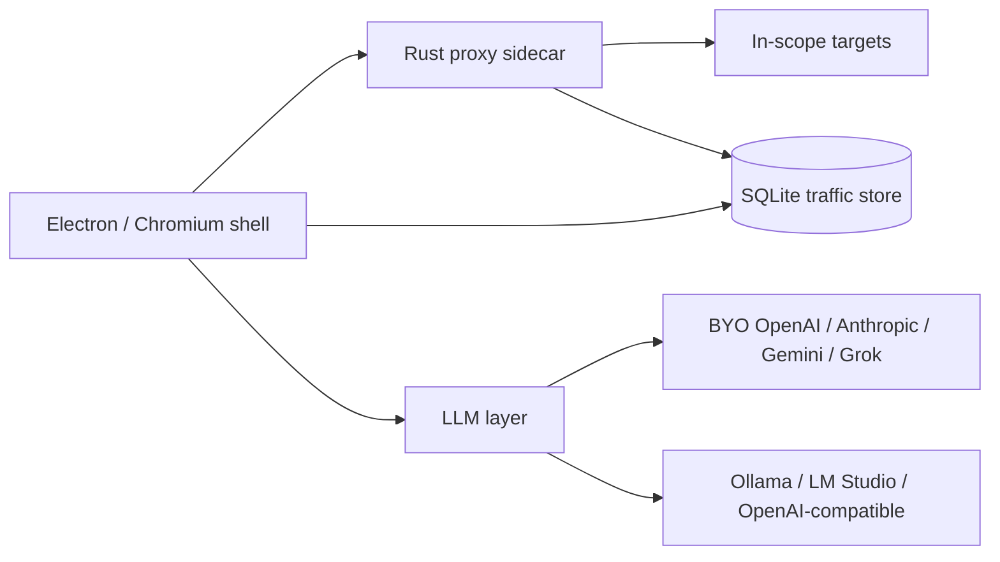

# Lurkwire

Burp Suite + an LLM, built into a browser you live in.

## Status

Pre-alpha, under active development. Ubuntu/Linux first, then macOS and Windows.

## What it is

Lurkwire is an AI-native security browser for developers, pentesters, and bug bounty hunters. It is a daily-driver Chromium browser with a built-in intercepting proxy, Repeater, fuzzer, and scanner, plus your own or local LLMs. Capture works with zero setup because we own the browser — and the AI drafts while a human always sends.

## Planned v0.1 features

- Electron/Chromium daily-driver browser
- Rust intercepting TLS MITM proxy with a per-install CA trusted only inside the app
- Per-project traffic store (HTTP history)
- Repeater
- Intruder-lite
- JWT/session tooling
- OOB collaborator
- Passive scanner and anomaly detection
- Recon / site-intel panel
- Provider-agnostic LLM layer (bring your own OpenAI, Anthropic, Gemini, or Grok keys, or run local Ollama, LM Studio, or any OpenAI-compatible endpoint) — AI drafts, a human sends

## Guardrails by design

- Scope allowlist enforced in the proxy
- Rate limiting
- Global kill switch
- Append-only, hash-chained audit log
- Authorization attestation per project
- Secret redaction before anything goes to a cloud model
- Local-only mode

## Architecture at a glance

## Roadmap

Linux first, then macOS and Windows.

## Responsible use

Lurkwire is built for authorized security testing: systems you own, systems you have written permission to test, and targets that are in scope for a bug bounty or vulnerability disclosure program you're participating in. Respect each program's rules, scope and rate limits. Lurkwire's scope allowlist makes it easy to load a program's in-scope assets and keep active testing inside them.

## License

TBD
